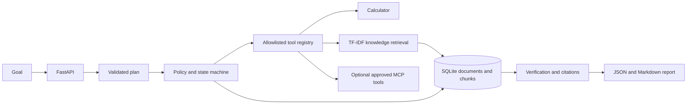

# AgentForge AI

AgentForge AI is a small, locally runnable agent orchestration service. It turns a goal into a validated plan, runs only registered tools, retrieves evidence from user-provided TXT/Markdown documents, records an auditable trace, checks citations, and persists a JSON/Markdown report.

The default provider is deterministic and offline. This is an engineering demonstration, not a truth guarantee or a production-ready multi-user service.

## Why this project

Agent workflows are easier to inspect and govern when planning, authorization, execution, evidence, and verification are explicit. AgentForge demonstrates those boundaries in a runnable API rather than hiding them inside a chat loop.

## Features

- FastAPI API with OpenAPI documentation and SQLite persistence.
- Pydantic-validated plans, dependency-cycle checks, explicit run states, bounded execution, cancellation, and audit events.
- Allowlisted calculator, local document search, knowledge retrieval, and run inspection tools with strict input schemas.
- Local TXT/Markdown ingestion, chunking, source metadata, TF-IDF ranking, and citation-ID validation.
- Deterministic mock provider for offline tests and optional Anthropic SDK adapter.
- Official MCP Python SDK stdio client with schema validation and explicit tool allowlists; MCP tools are approval-gated.
- Structured JSON and Markdown reports, synthetic ML ranking evaluation, Docker, and CI.

## Architecture



## End-to-end flow

1. `POST /api/v1/runs` validates a goal and persists a pending run.
2. The configured provider proposes a Pydantic-validated plan; deterministic policy checks tool names, task count, dependency references/cycles, and approval flags.
3. The orchestrator orders tasks by dependency, enforces run/tool limits, validates arguments, and records sanitized events and structured results.
4. Retrieval searches local document chunks with scikit-learn TF-IDF cosine similarity. Retrieved content is untrusted evidence, never an instruction source.
5. Independent checks validate task completion, dependencies, tool outcomes, and citation IDs before storing the report.

## Technology

Python 3.12+ (tested here on 3.14.2), FastAPI, Pydantic v2, SQLite, pytest, scikit-learn, the Anthropic Python SDK, and the official Python MCP SDK. Exact versions are constrained in `pyproject.toml`; CI runs Python 3.12 and 3.13.

## Repository layout

```text
app/                 API, orchestration, policies, tools, RAG, MCP, reporting
tests/               unit, API, persistence, and local MCP integration tests
scripts/              local MCP test server and retrieval evaluation
docs/                 architecture, API, security, development, roadmap
.github/workflows/    CI checks
Dockerfile            non-root API image
compose.yaml          loopback-bound local deployment
```

## Install

Prerequisites: Python 3.12+, pip, and Git. No credentials are required for the default workflow.

Unix-like shells:

```sh
git clone <your-repository-url> agentforge-ai
cd agentforge-ai
python3 -m venv .venv
. .venv/bin/activate
python -m pip install --upgrade pip
python -m pip install -e ".[dev]"
cp .env.example .env
```

Windows PowerShell:

```powershell
git clone <your-repository-url> agentforge-ai
Set-Location agentforge-ai
py -3.12 -m venv .venv
.\.venv\Scripts\Activate.ps1
python -m pip install --upgrade pip
python -m pip install -e ".[dev]"
Copy-Item .env.example .env
```

The app creates its SQLite schema on startup. By default the database is `./data/agentforge.db`; override it with `AGENTFORGE_DATABASE_PATH`. `.env` is ignored by Git.

## Configure and run

The mock LLM provider is the default; no key is needed. Set `AGENTFORGE_ADMIN_TOKEN` to a strong random value to enable approval and cancellation endpoints. To use the optional Anthropic adapter, set `AGENTFORGE_LLM_PROVIDER=anthropic` and provide `ANTHROPIC_API_KEY` through your shell's secret/environment mechanism. Never commit credentials.

Unix-like shells:

```sh
export AGENTFORGE_ADMIN_TOKEN='replace-with-a-long-random-value'
uvicorn app.main:app --reload --host 127.0.0.1 --port 8000
```

Windows PowerShell:

```powershell
$env:AGENTFORGE_ADMIN_TOKEN = "replace-with-a-long-random-value"
uvicorn app.main:app --reload --host 127.0.0.1 --port 8000
```

Health: `http://127.0.0.1:8000/health`. Interactive OpenAPI: `http://127.0.0.1:8000/docs`.

## Try a run

```sh
curl -s http://127.0.0.1:8000/health
curl -s -X POST http://127.0.0.1:8000/api/v1/runs \
	-H 'Content-Type: application/json' \
	-d '{"goal":"Calculate 12 * 8"}'
```

Typical run response (timestamps and ID vary):

```json
{
	"id": "<run-id>",
	"goal": "Calculate 12 * 8",
	"status": "SUCCEEDED",
	"created_at": "<UTC timestamp>",
	"updated_at": "<UTC timestamp>",
	"error": null
}
```

Use that ID to inspect `/api/v1/runs/{run_id}/plan`, `/events`, and `/report`. The report answer for this example is `12 * 8 = 96.0`.

## Ingest and retrieve evidence

```sh
curl -s -X POST http://127.0.0.1:8000/api/v1/knowledge/documents \
	-H 'Content-Type: application/json' \
	-d '{"source_name":"guide.md","content":"Payments above $500 require manager approval."}'
curl -s -X POST http://127.0.0.1:8000/api/v1/knowledge/search \
	-H 'Content-Type: application/json' \
	-d '{"query":"payment approval","limit":3}'
curl -s -X POST http://127.0.0.1:8000/api/v1/runs \
	-H 'Content-Type: application/json' \
	-d '{"goal":"According to the document, explain payment approval"}'
```

Only `.txt` and `.md` source names are accepted. Search scores use TF-IDF cosine similarity and can be empty if there is no lexical match. Reports cite actual retrieved chunk IDs and state when evidence is insufficient.

## LLM and MCP

The deterministic `MockProvider` supports planning and grounded summaries offline. `AnthropicProvider` is optional and uses `ANTHROPIC_API_KEY`, a 30-second timeout, and one SDK retry. Model output remains untrusted and plans pass deterministic validation.

MCP is disabled unless explicitly used in administrator-controlled application configuration. `MCPAdapter.connect_stdio(command, args, allowlist)` discovers only allowlisted tools; `register_tools` validates their JSON schemas and marks them approval-required. `scripts/mock_mcp_server.py` is a local example used by integration tests. Never accept MCP commands or server credentials from public API input. See [docs/development.md](docs/development.md) and [docs/security.md](docs/security.md).

## Tests and evaluation

```sh
ruff check app tests scripts
pytest --cov=app --cov-report=term-missing
python scripts/evaluate_retrieval.py
```

The default test suite makes no paid API calls. The MCP integration test launches a local Python subprocess. The retrieval script uses four synthetic relevance cases; it is illustrative, not a benchmark claim.

## API reference

| Method | Endpoint |
| --- | --- |
| `GET` | `/health`, `/ready` |
| `POST` | `/api/v1/runs` |
| `GET` | `/api/v1/runs/{run_id}` |
| `GET` | `/api/v1/runs/{run_id}/plan` |
| `GET` | `/api/v1/runs/{run_id}/events` |
| `GET` | `/api/v1/runs/{run_id}/report` |
| `POST` | `/api/v1/knowledge/documents` |
| `POST` | `/api/v1/knowledge/search` |
| `GET` | `/api/v1/tools` |
| `POST` | `/api/v1/runs/{run_id}/approve` |
| `POST` | `/api/v1/runs/{run_id}/cancel` |

See [docs/api.md](docs/api.md) for example requests and authentication assumptions. OpenAPI is generated at runtime by FastAPI.

## Security, limitations, and roadmap

The service is intended for trusted local use. Approval/cancellation require `X-Admin-Token` when `AGENTFORGE_ADMIN_TOKEN` is configured. Do not expose it to the public internet without real authentication, authorization, rate limiting, and deployment hardening. Documents and tool output are untrusted. The service bounds work but does not guarantee factual correctness.

Current limitations: synchronous run execution; no UI, streaming, user/tenant isolation, durable job queue, document deletion or retention scheduler, encryption at rest, or neural embeddings. The ranking component is lexical TF-IDF, and the mock provider deliberately produces deterministic answers. See [docs/security.md](docs/security.md) and [docs/roadmap.md](docs/roadmap.md).

## Docker

```sh
export AGENTFORGE_ADMIN_TOKEN='replace-with-a-long-random-value'
docker compose up --build
```

Compose binds the API to loopback and persists SQLite in a named volume. For a deployment beyond a local machine, add network controls and production authentication first.

## Contributing and license

Contributions should include focused tests and update documentation when behavior changes. Run Ruff and pytest before opening a pull request. The project is licensed under the MIT License; see [LICENSE](LICENSE).