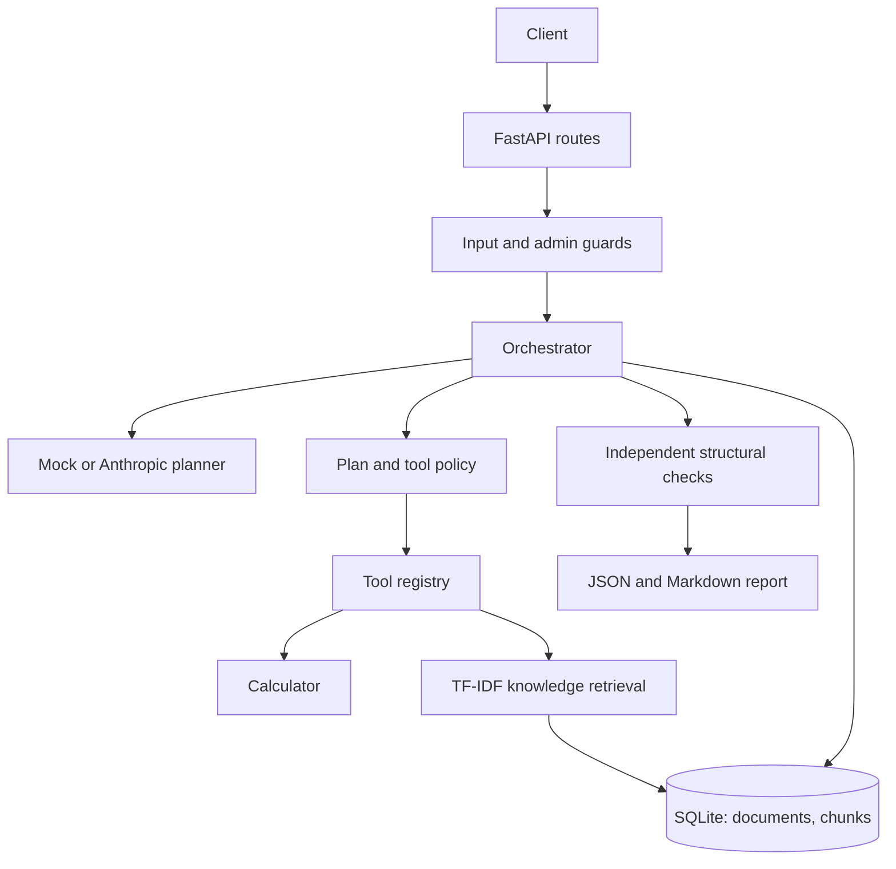

# Architecture

AgentForge is a synchronous, single-process FastAPI service backed by SQLite. Runs are executed in the request worker, so the initial release favors inspectability and a small deployment footprint over throughput.

## Run flow

The API stores a pending run before planning. Pydantic validates the proposed plan; policy rejects unknown tools, excess tasks, invalid dependencies/cycles, and high-risk tasks without an approval flag. The orchestrator orders dependencies, checks per-run limits, validates tool arguments, calls registered handlers, stores results separately from sanitized execution events, then checks task completion, dependencies, tool outcomes, and citation IDs before reporting.

Plans and runs are bounded. There is no model-generated code execution, shell tool, filesystem tool, autonomous replanning, or retry loop. A human approval request is tied to a stored request ID and task ID. The local admin token is required for approval and cancellation.

## Retrieval and ML

TXT and Markdown are normalized and chunked with overlap. Chunk text and source metadata are stored in SQLite. The `RelevanceRanker` interface currently uses scikit-learn TF-IDF features with cosine similarity; this is lexical retrieval, not a neural embedding model. `scripts/evaluate_retrieval.py` evaluates four small synthetic query/relevance cases using MRR and Recall@1. The sample is illustrative and not a generalization claim.

## Persistence

SQLite tables store run state, events, task outputs, document metadata, and document chunks. Database files are retained until an operator removes them; there is no retention scheduler, document deletion endpoint, encryption-at-rest, or multi-tenant isolation in this local version.